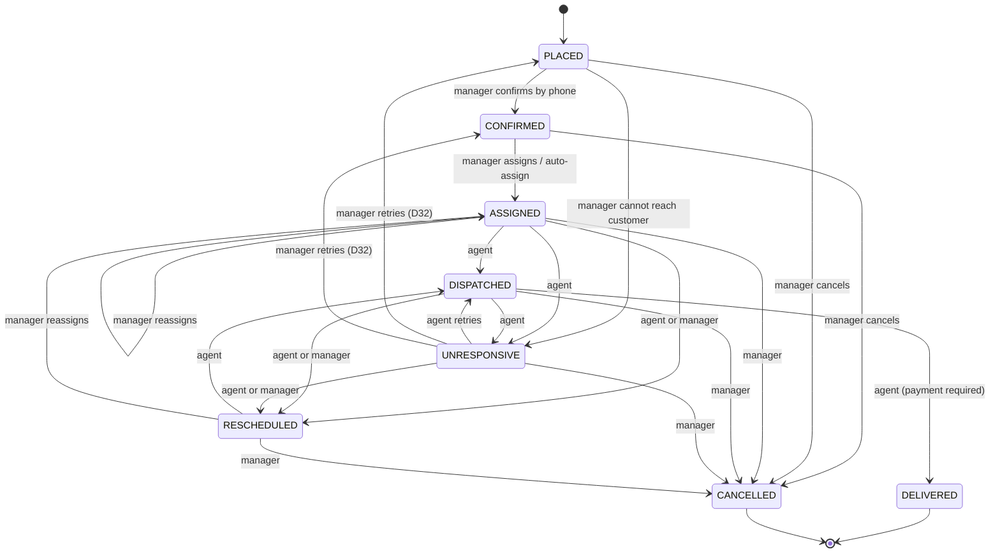

# Order Lifecycle

Status: Draft v0.1, 2026-11-15. Statuses `DELIVERED`, `UNRESPONSIVE` and `RESCHEDULED` come from the company's current sheet legend. `PLACED`, `ASSIGNED`, `DISPATCHED` and `CANCELLED` follow the described flow and the agreed design. `CONFIRMED` was added 2026-11-19 (D21); its **name is a proposal** pending the developer's OK.

## Statuses

| Status | Meaning |
|---|---|
| `PLACED` | Order received, not yet phone-confirmed |
| `CONFIRMED` | Manager phoned the customer and confirmed the order; not yet assigned (D21, name proposed) |
| `ASSIGNED` | Manager or system assigned an agent |
| `DISPATCHED` | Agent is on the way to the customer (customer gets an SMS) |
| `DELIVERED` | Delivered and payment recorded. Final |
| `UNRESPONSIVE` | Agent could not reach the customer |
| `RESCHEDULED` | New delivery date agreed |
| `CANCELLED` | Order cancelled. Final |

## State diagram

## Transition rules

| From | To | Who | Requirements |
|---|---|---|---|
| PLACED | CONFIRMED | Manager | Manager has phoned the customer (D21) |
| PLACED | UNRESPONSIVE | Manager | Customer could not be reached at confirmation (D21). Increments `attemptCount` |
| CONFIRMED | ASSIGNED | Manager | Agent is active; stock available for all items (auto-assign enforces; manual assign warns and requires manager confirmation to override) |
| PLACED, CONFIRMED | CANCELLED | Manager | Reason |
| ASSIGNED | DISPATCHED | Assigned agent | Triggers customer SMS |
| ASSIGNED, DISPATCHED, UNRESPONSIVE | RESCHEDULED | Assigned agent or manager | New date required |
| DISPATCHED | DELIVERED | Assigned agent | Payment method and amount required; stock deducted |
| ASSIGNED, DISPATCHED | UNRESPONSIVE | Assigned agent | Increments `attemptCount` |
| UNRESPONSIVE | DISPATCHED | Assigned agent | Retry |
| UNRESPONSIVE | PLACED, CONFIRMED | Manager | Retry (D32). Releases the assigned agent, if any (the assistant's reading of D32, to confirm) |
| RESCHEDULED | DISPATCHED | Assigned agent | On or after the new date (not enforced strictly) |
| ASSIGNED, RESCHEDULED | ASSIGNED (different agent) | Manager | Only before dispatch (D33). Releases the old agent's reservation, notifies both agents |
| Any non-final | CANCELLED | Manager | Reason required |

Anything not listed is rejected. `DELIVERED` and `CANCELLED` are final; corrections are made by the manager through an audited adjustment (design to be agreed, Q15).

## Side effects per transition

| Transition | Side effects |
|---|---|
| to PLACED | Manager notification; stored notification |
| to CONFIRMED | Stored history entry only (no SMS or sheet row yet; UNCONFIRMED) |
| to ASSIGNED | Agent notification; sheet row created or updated |
| to DISPATCHED | Customer SMS (outbox); sheet update |
| to DELIVERED | Payment row; stock movement; `deliveredAt`; sheet update (status DELIVERED) |
| to UNRESPONSIVE / RESCHEDULED | Manager notification; sheet update |
| to CANCELLED | Release reservation; sheet update (handling of cancelled rows, Q5) |

All of these run inside one service method; external effects are queued in the outbox (`ARCHITECTURE.md` 4.4).

## Open points

- Q16 is answered (D21): confirmation is required. Unreachable at confirmation ends in `UNRESPONSIVE` (developer, 2026-11-19). Retry from `UNRESPONSIVE` is answered by D32 and reassignment by D33 (developer, 2026-11-23). Still open: whether the client agrees, and the final status name of `CONFIRMED`.
- **Implemented (2026-11-23) in `apps/api/src/orders/order-transitions.ts`:** every transition above except `DELIVERED`, which waits for payments and stock. Side effects (notifications, SMS, sheet, stock) are not built; the single service method `OrderStatusService.change` is where they will be queued. Manager assignment does not yet check county coverage or stock (D8, ROADMAP steps 5 and 7).
- Cancellation, refusal and return policy (Q15).
- Sheet text for `ASSIGNED` and `DISPATCHED` (Q17).
